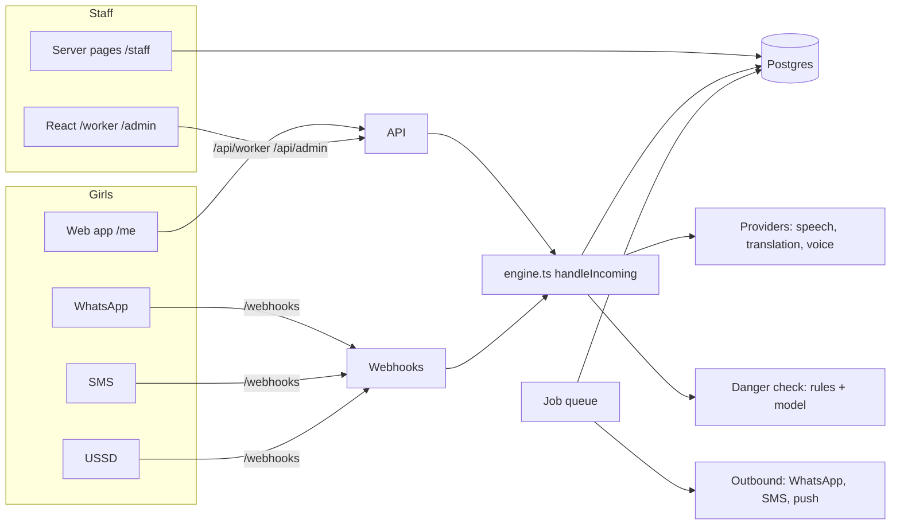

# Architecture

How Ubah is put together, for someone about to change it. The README covers running it, the roles
and the message flow in detail; this page is the map. Deployment is in `docs/deployment.md`.

## The pieces

One Node process (Express 5, TypeScript run by tsx) serves everything:

| Part | Where | Notes |
|---|---|---|
| Landing page | `src/web/landing.ts` | Server-rendered, in four languages, with a quick-exit bar. |
| React app | `web/` → built into `web/dist`, files under `/ui/` | `/login`, the girls' space `/me`, `/worker`, `/admin`. Workers' and admins' screens are loaded only when opened. |
| JSON API | `src/api/` (`/api/auth`, `/api/me`, `/api/worker`, `/api/admin`, `/api/strings`) | Every route checks the role on the server (`src/auth/roles.ts`). |
| Staff platform | `src/web/*.ts` under `/staff` | Server-rendered pages: inbox, content and translation studios, admin, dashboard, payments, models, confidential reports. |
| Webhooks | `src/server.ts`, `src/channels/` | WhatsApp (Meta), SMS and USSD (Africa's Talking), M-Pesa callbacks. |
| Old app API | `src/web/appApi.ts` under `/app/api` | The earlier installable app (device token, no phone). `/app` itself now says the app has moved. |
| Conversation engine | `src/engine.ts` | One function, `handleIncoming()`, for every channel. |
| Background jobs | `src/jobs/` | Postgres-backed queue; check-ins, retries, urgent reminders, recovery. |
| Database | `src/db.ts`, `migrations/` | PGlite (Postgres in WASM) for development and tests; real Postgres in production. |

## A girl's message, end to end

1. **Arrives.** On the web: `POST /api/me/messages` (or `/voice`), with an id from her phone so a retry is
   handled once (`inbound_messages`, provider `web`). On WhatsApp or SMS, the provider's message id does
   the same, and the raw message is stored encrypted until handled, so a crash never loses it
   (`src/channels/inbound.ts`, recovered by the `inbound.recover` job).
2. **Voice → text** (`src/providers/speech.ts`): OpenAI-compatible, Meta MMS or Google Chirp, chosen per
   language (`STT_<LANG>_*`). The recording is kept, encrypted, only if she shares her voice.
3. **Into English** (`src/providers/translation.ts`): Google Translate. The original is always kept.
   Her own words count as English only if they look English (`looksEnglish`); a mock translation is
   never used as an answer.
4. **Danger check on both texts** (`analyseBoth` in `src/ml/models.ts`): per-language danger-word lists
   (always win) plus a trained classifier. Either match makes it **urgent**: she gets the emergency or
   clinic message at once, her worker and every nurse are alerted by SMS, and a case is opened
   (`src/cases.ts`). This runs before anything else, whatever step she is on.
5. **Answer or hand over.** A clear match (score ≥ `MIN_ANSWER_SCORE`) with approved, published content is
   sent word for word, marked with its source and "not medical advice". Otherwise, or if she asks for a
   person (DADA), it waits for her assigned nurse or Dada.
6. **A person replies** in English (`src/replies.ts`): a native-speaker-checked template if one matches,
   else machine translation (marked), sent back on her channel. If translation fails, nothing is sent and
   the worker is told.
7. **Delivered** (`src/channels/outbound.ts`): WhatsApp (held if her 24-hour window is closed), SMS (split
   into parts), or her web conversation plus an empty push notice. Failures go to the outbox and are
   retried by jobs.

## Who can see what

| Role | Signs in with | Sees |
|---|---|---|
| Girl | phone + SMS code once, then a 4-digit PIN; session locks after 15 minutes idle | Only her own conversation, passes, journal and reports |
| Nurse, Dada (health worker) | password + authenticator app (nurse) or SMS code (Dada) | Girls assigned to them; their messages only if she shares them; urgent messages always. Plus a "Waiting for a Dada" list of girls with no worker and an open case (her words only if she shares); taking one assigns her |
| Protection officer | password + authenticator app | Confidential reports only (`/staff/safeguarding`) |
| Admin | password + authenticator app | Staff, clinics, sites, assignments, audit log; not report contents |
| Other staff roles | password, + authenticator app for partner, reviewer and editor | Their own area (clinic desk, partner, reviewer, editor, translator) |

- Girls' and staff sessions are stored server-side as token hashes (`girl_sessions`, `staff_sessions`).
- Every look at a girl's profile, messages, voice or report is written to `access_log` (who, whom, what,
  when; never content), at most one line per person per 10 minutes.
- Wrong PINs and passwords are counted and lock the account (`pin_attempts`, `staff.failed_logins`).
- A girl's wellbeing journal has no staff route at all (`src/wellbeing.ts`).

## Where data lives

All in Postgres. Tables by purpose (from `migrations/`):

| Purpose | Tables |
|---|---|
| Girls | `users`, `consents`, `girl_otp`, `girl_sessions`, `pin_attempts`, `push_subscriptions`, `assignments` |
| Conversation | `messages`, `inbound_messages`, `voice_notes`, `media`, `replies`, `answer_templates`, `outbox`, `pending_outbound` |
| Care | `cases`, `case_notes`, `case_events`, `case_protection`, `clinics`, `sites`, `passes`, `checkins`, `labels` |
| Safety | `safeguarding_reports`, `safeguarding_events`, `protection_steps`, `protection_contacts`, `wellbeing_entries` |
| Content | `content_topics`, `content_versions`, `string_versions`, `glossary_terms`, `model_versions` |
| Staff | `staff`, `staff_sessions`, `staff_otp`, `staff_recovery_codes`, `staff_tokens` |
| Records | `audit_log` (append-only: a trigger refuses edits and deletes), `access_log` |
| Payments | `dada_payouts`, `payout_batches`, `mpesa_callbacks` |
| Jobs | `jobs` |

**Encrypted in the application** (AES-256-GCM, `ENCRYPTION_KEY`, `src/privacy.ts`): phone numbers
(`users.phone_enc`; lookups use a keyed hash, `HASH_SECRET`), staff authenticator secrets, voice notes,
incoming messages awaiting handling, wellbeing notes, and confidential reports (her words and the notes).

**Not encrypted in the application:** conversation text in `messages` and `replies`, case notes. These rely
on the database's own disk encryption and encrypted backups (`docs/deployment.md`).

Her data leaves when she asks (`src/erase.ts`: DELETE on any channel, or "Wipe my history"), and, if the
team turns it on, after a set time (`src/retention.ts`, `RETENTION_MODE`; no default periods).

## Outside services

Each sits behind one module and has a mock used when its key is missing (development and tests).

| Service | Module | Key (environment) | If missing |
|---|---|---|---|
| Speech-to-text | `src/providers/speech.ts` | `STT_API_KEY`, or `STT_<LANG>_*` per language | Mock transcript |
| Translation | `src/providers/translation.ts` | `GOOGLE_TRANSLATE_API_KEY` | Mock; never used as an answer |
| Spoken replies | `src/providers/voice.ts` | `ELEVENLABS_API_KEY`, `VOICE_REPLIES` | Text only |
| WhatsApp | `src/channels/whatsapp.ts` | `WHATSAPP_*` | Logged, not sent |
| SMS, USSD | `src/channels/sms.ts` | `AT_*` | Logged, not sent |
| Web push | `src/push.ts` | `VAPID_*` | No notices |
| M-Pesa | `src/payments/mpesa.ts` | `MPESA_*` | Simulated, marked with a MOCK receipt; nothing sent |
| AI drafts (translators only) | `src/ai/translate.ts` | `LLM_*` | Button explains how to switch it on |

No outside service writes health advice: answers come from approved content or from a person.

## Security controls

- **Headers** (helmet): strict CSP (scripts, styles and fonts from Ubah only), no framing, HSTS in
  production, `no-referrer`, `no-store` on staff pages.
- **Cross-site requests:** staff forms carry a CSRF token; JSON changes need the `X-Ubah: 1` header.
- **Rate limits** on logins and webhooks; webhooks authenticated (WhatsApp signature with the app secret,
  SMS key, M-Pesa path token).
- **Request size limits** (JSON 256 kB, forms 32 kB).
- **Logs** are JSON lines with no message text, phone numbers, cookies or keys.
- **Compression** only for the built app files (`/ui`), never pages or API answers (BREACH).
- **Configuration** is validated at startup (`src/config.ts`); production refuses to start without its
  secrets.

## Tests

- `npm test` runs the server tests (`test/`, vitest, against PGlite), then the timed load tests on their own
  (`test/load.test.ts`, `npm run test:load`), then the web tests (`web/src`, jsdom):
  engine, channels, roles and access, every route and link per role, safeguarding, wellbeing, offline
  queue, accessibility (axe) and colour contrast.
- `npm run test:pg` runs the server tests against a real Postgres.
- `npm run eval:languages` measures speech-to-text and translation per language on recorded samples.

## Changing things safely

- **Database:** add a new numbered file in `migrations/`; never edit an applied one (checksums stop the app).
- **A new girl-facing word:** add it to `src/i18n.ts`; it shows in English until a translation is approved
  in the Translation studio.
- **A new route:** add it to `test/inventory.ts`; the crawler test checks every link and form per role.
- **A new outside service:** one module in `src/providers/` or `src/channels/`, with a mock.
